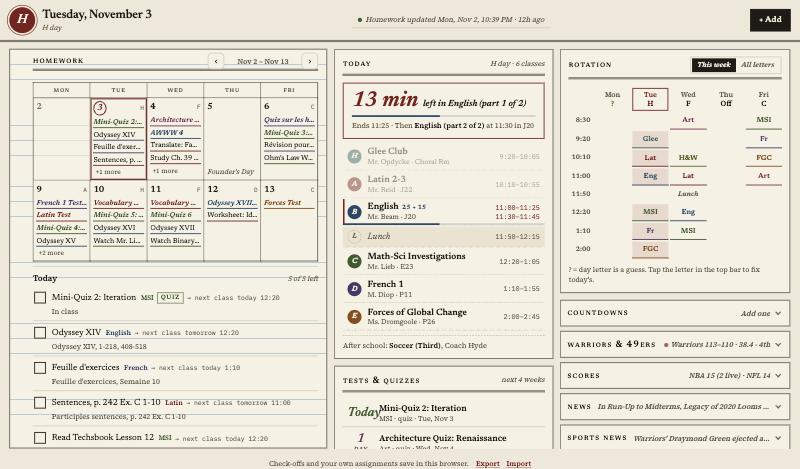
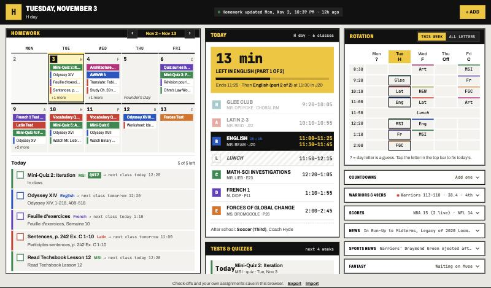
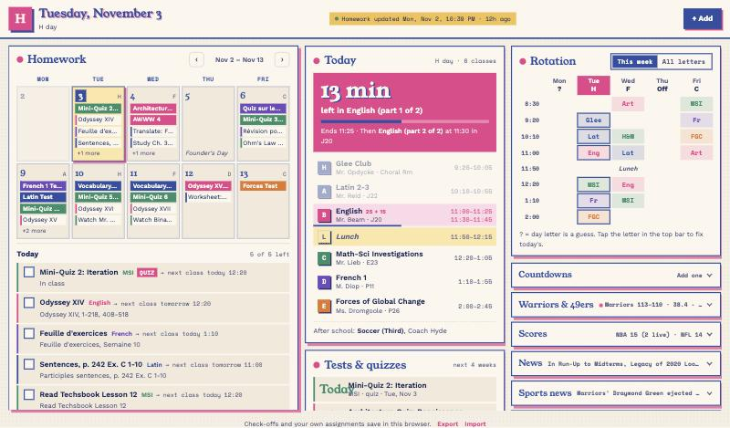
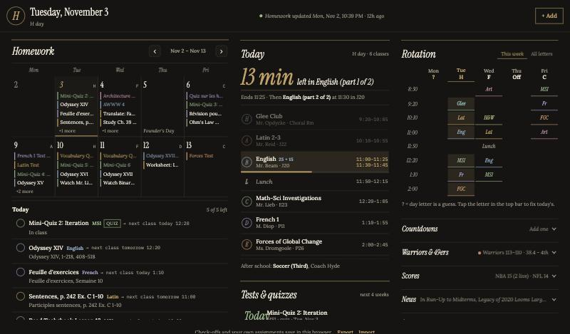

# Planner theme concepts: grade these

Four complete looks for the same planner. Each is a real, working stylesheet, not a mockup, and changes only the look, not the data or the layout logic. Grade them below. The winner becomes the default, and I'll take it further than a skin: spacing, type scale, and the game view to match.

**Try any of them live** by adding `?theme=` to the site address:

- Ledger: https://shxbainu.github.io/rl-planner/?theme=ledger
- Timetable: https://shxbainu.github.io/rl-planner/?theme=timetable
- Riso: https://shxbainu.github.io/rl-planner/?theme=riso
- Study Hall: https://shxbainu.github.io/rl-planner/?theme=studyhall

All screenshots show Tuesday, Nov 3 at 11:12 (H day, 13 minutes left in English part 1), so the "now" states are visible.

For reference, the current site: `screens/0-current-laptop.jpg`.

---

## 1 · Ledger: "the school register, 1645 onward"

- **Feels like:** a leather-bound register in the headmaster's office: rag paper, iron-gall ink, a wax seal.
- **Type:** Newsreader (italic numerals, small-caps section labels) for headings, Source Serif 4 for body text, IBM Plex Mono for times.
- **Colors:** paper `#EFE8D8`, ink `#1F1A14`, oxblood `#7B1E1E`, faded-blue ruling `#B9CBD8`.
- **Signature details:**
  - The homework panel is ruled paper with a red margin line.
  - The calendar is an inked grid with no gaps.
  - The day letter is a round "seal".
  - Headings sit on double rules, like a printed register.
- **Weak spot:** the busiest-looking of the four; the ruled lines compete a little with the checklist.

Phone: `screens/1-ledger-phone.jpg`

## 2 · Timetable: "a Swiss station departure board"

- **Feels like:** standing under the board at Zürich HB: everything is a row, every row has a time.
- **Type:** Archivo (condensed caps for headers, 75–85% width) for headings and body, JetBrains Mono for every time and number.
- **Colors:** enamel `#E9E7E1`, black `#111111`, signal yellow `#F5C400`, one red `#D8322B`.
- **Signature details:**
  - Every panel has a black header strip in yellow caps.
  - The class you're in shows inverted (black row, yellow time), like the next departure.
  - Lunch is hatched like a platform closure.
  - Tests are solid class-color chips you can spot from across the room.
- **Weak spot:** the loudest of the four; caps everywhere can feel shouty late at night.

Phone: `screens/2-timetable-phone.jpg`

## 3 · Riso: "a two-ink risograph zine"

- **Feels like:** a club zine off the art-room risograph: cream stock, slightly misaligned ink.
- **Type:** Young Serif (chunky 1970s serif) for headings, Work Sans for body text, Space Mono for times.
- **Colors:** cream `#F5EFE3`, federal blue `#2F4FA2`, fluorescent pink `#E8418C`, yellow `#F2C14E`.
- **Signature details:**
  - Every box has a hard pink "second pass" offset.
  - The headings are misregistered by 2px.
  - The background has a faint pink halftone dot field.
  - The "now" block is solid pink.
- **Weak spot:** the most playful; the offsets add visual weight on a small screen.

Phone: `screens/3-riso-phone.jpg`

## 4 · Study Hall: "the library after hours"

- **Feels like:** the reading room at 10pm: green-shade lamp, brass, quiet.
- **Type:** Instrument Serif (big italic numerals and headings) for headings, Lora (your pick) for body text, IBM Plex Mono for times.
- **Colors:** walnut `#151412`, bone `#EBE4D4`, brass `#C4A061`, hairlines `#33302A`.
- **Signature details:**
  - No boxes at all: brass hairlines and space instead.
  - The countdown is a huge italic number.
  - Class letters sit in thin rings.
  - A news headline draws a brass underline when you hover it.
- **Weak spot:** dark-only, and the lowest contrast of the four in bright daylight.

Phone: `screens/4-studyhall-phone.jpg`

---

## Grade sheet

Score 1–10. "Lives with it" means: would you still like it after looking at it every day for a month?

| | Mood | Readable at a glance | Phone | Unique | Lives with it | Overall | Notes |
|---|---|---|---|---|---|---|---|
| 1 Ledger | | | | | | | |
| 2 Timetable | | | | | | | |
| 3 Riso | | | | | | | |
| 4 Study Hall | | | | | | | |

Mixing is fine. For example: "Timetable's schedule column, Study Hall's colors."

## Where each one goes next, if it wins

- **Ledger:** a week laid out as a two-page spread, a "signed" stamp when a day's homework is done, and an inked box score with column rules.
- **Timetable:** the schedule as a full departure list ("Platform J20, departs 11:00"), the scoreboard as an arrivals board, and countdowns as platform clocks.
- **Riso:** each class gets its own ink pairing, and tests/quizzes get a stamped "QUIZ" label.
- **Study Hall:** a light "morning" version for daytime, a box score as a quiet ledger with brass column leaders, and a reading-list style homework view.

Every concept follows the same rules: no gradients-as-decoration, no glow, no bounce, no stock photos, no invented content. Motion is limited to things like the underline that draws in on hover.
